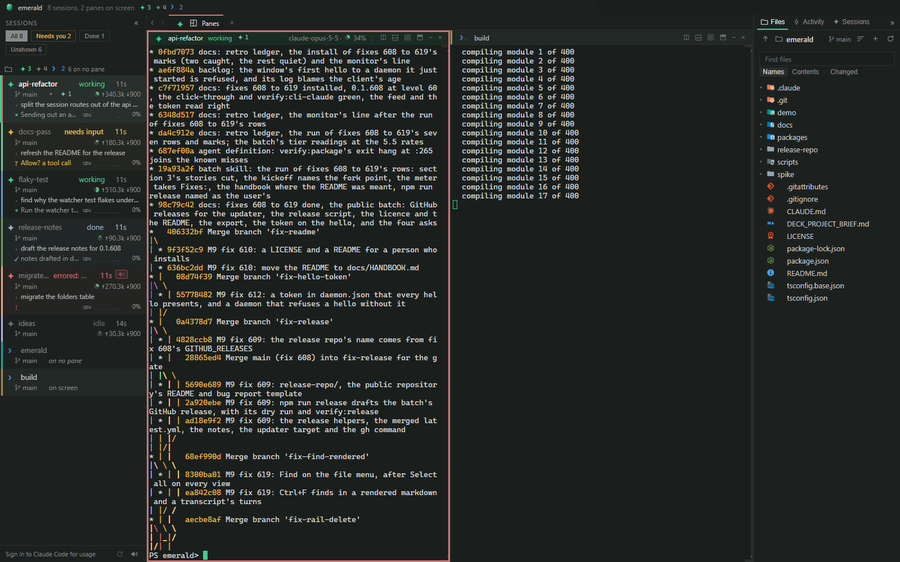

# Emerald

Emerald is a desktop app for running and supervising several Claude Code sessions at once on Windows and on a Mac with Apple silicon.
Each session gets a pane in a split layout and a row in the sidebar that says whether it is working, waiting or needs you, beside the commit graph of the repository it works in.
A daemon owns the terminals, so closing the window leaves every session running and the next window picks them up.

This repository holds Emerald's code under the MIT licence, its installers on the releases page and its issues.



## Requirements

- Windows 10 or 11, on arm64 or x64.
- macOS 14 or newer on Apple silicon (M1 and later). There is no Intel build.
- Git and Claude Code on the PATH.
- Node 24 or newer, only to build from source. The installed app brings its own.

## Install

Download the installer from the latest release at https://github.com/zacharykeeton/emerald/releases/latest: `Emerald-setup-<version>-x64.exe` for most PCs, `Emerald-setup-<version>-arm64.exe` for an ARM PC (Settings, System, About shows the system type).

The installer is not signed, so Windows SmartScreen stops it the first time with "Windows protected your PC". Click **More info**, then **Run anyway**. That happens once per download. Your browser may also warn that the file is not commonly downloaded; keep it.

The install is per user and needs no admin rights. It goes to `%LOCALAPPDATA%\Programs\emerald`, adds the `emmer` command to your PATH for any terminal opened afterwards, puts Emerald in the Start menu and on the desktop, and starts it. It also adds **Open in Emerald (Claude)** and **Open in Emerald (shell)** to Explorer's right-click menu on a folder and on a folder's empty space (under **Show more options** on Windows 11); either opens a new tab in Emerald with a Claude session or a shell started in that folder.

## First launch

Emerald learns what each Claude Code session is doing from Claude Code's hooks, so the first window shows a banner: "Claude Code hooks are not installed, so emerald cannot see what its sessions are doing." **Install hooks** writes them into `~/.claude/settings.json` beside any hooks you already have; **Not now** hides the banner until the next start. The banner's **Test** button sends one event through the installed hook, to check it reaches the app.

Installing the hooks also takes Claude Code's status line slot, since the status line is the only place Claude Code reports the model and how full the context window is. Your previous status line is kept and still runs after Emerald's, so it shows as before, and `emmer hooks uninstall` puts it back. The same step adds the `emmer-cli` skill to `~/.claude/skills`, so a Claude session knows how to drive the other sessions with `emmer`.

Sessions started before the hooks were installed report nothing; start them again, or resume them, once the banner is gone.

## Updates

Emerald checks the releases every few hours. When a new one is out it downloads on its own, and once it is ready a badge at the right of the title row reads **Restart to update**. Click it to close the window, install the new version and start it again, about a minute in all; every pane comes back through Resume. Nothing installs until you click. If the download fails, the badge reads `Retry <version>`; click it to try again.

## Uninstall

1. Remove Emerald in Settings, Apps, Installed apps. That removes the program, the PATH entry, the "Open with" entries for `.md` and `.json`, the two **Open in Emerald** items, and Emerald's hooks in `~/.claude/settings.json`, putting your previous status line back and removing the `emmer-cli` skill. An Emerald older than 0.1.620 leaves the hooks behind: there, run `emmer hooks uninstall` in a terminal first.
2. What stays, for you to delete if you want it gone: `~/.emerald` (your layouts, the session list and the logs), `%APPDATA%\emerald` (the window's own settings) and `%LOCALAPPDATA%\emerald-updater` (downloaded installers).

## On a Mac

Download `Emerald-<version>-arm64.dmg` from the latest release, open it and drag Emerald to Applications. The app is not signed with an Apple Developer ID, so macOS says it is damaged or cannot be checked until its quarantine is cleared, once per download: `xattr -cr /Applications/Emerald.app`. For `emmer` in a terminal, link it onto the PATH: `sudo mkdir -p /usr/local/bin && sudo ln -sf "/Applications/Emerald.app/Contents/Resources/bin/emmer" /usr/local/bin/emmer`; the window shows this line in a banner while `emmer` is not on the PATH. There is no in-app update on a Mac, since macOS applies an update only to a signed app: the badge says when a release is out and opens its page, and the new dmg goes over the old app the same way, quarantine and all. The app's chords are Ctrl on a Mac too for now, as on Windows; Cmd+C, Cmd+V and Cmd+Q do what they do in any Mac app, and Cmd+W closes the window. To uninstall, quit Emerald and drag it to the Trash, run `emmer hooks uninstall` first if the hooks are installed, and delete what stays if you want it gone: `~/.emerald`, `~/Library/Application Support/emerald` (the window's own settings) and the link, `sudo rm /usr/local/bin/emmer`.

## Remote hosts

A pane can run its session on another machine you reach over ssh. What the host needs: an ssh server that lets you in with a key (Emerald runs the system `ssh` in batch mode, so it never asks for a password and holds no keys of its own), `tar`, and Windows or macOS; a Linux host is refused for now. Every `Host` in your `~/.ssh/config` that names no wildcard is offered on the empty pane's `on` row, and `Add a host…` there takes any ssh destination. A host whose key this PC has never seen is refused until you have run `ssh <host>` once yourself and checked the fingerprint.

On first use Emerald copies a daemon, its `emmer` and a Node of their own to the host, 32 to 36 MB, into `~/.emerald-remote` (the Node under `node-<version>`, Emerald's part under its version), and runs `emmer hooks install` there, which writes the host's own `~/.claude/settings.json` beside any hooks it holds. That daemon has its own home and pipe, so an Emerald installed on the host is never touched. After an update only Emerald's part, under 2 MB, is copied again, and the old one is removed once the new daemon answers. No port is opened and nothing is forwarded: the window talks to the host's daemon over the ssh session's own input and output. To remove it from a Windows host, take its hooks out first with the kit's own command line, `& "$HOME\.emerald-remote\node-24.20.0\node.exe" "$HOME\.emerald-remote\<version>\cli\dist\main.js" hooks uninstall --home "$HOME\.emerald-remote"` in PowerShell there, then delete `~/.emerald-remote`.

What stays local for now: the files rail, the commit graph, the review tab and the Activity, Sessions and Stats tabs read this PC's disk, so for a remote folder they say so rather than draw it. A Claude Code that is installed on the host but not signed in asks for its login in the pane, as it would here.

## Build from source

With Git and Node 24 or newer:

```
git clone https://github.com/zacharykeeton/emerald.git
cd emerald
npm ci
npm run build
npm run build -w @emerald/app
npm run dist -w @emerald/app -- --x64
```

On an x64 PC that writes `packages/app/release-x64/Emerald-setup-<version>-x64.exe`. On an ARM PC leave out `-- --x64`; the installer lands in `packages/app/release/` as `Emerald-setup-<version>-arm64.exe`. Run the installer as above. One you built yourself carries no mark of the web, so SmartScreen does not stop it.

On a Mac with Apple silicon the last command is `npm run dist:mac -w @emerald/app`, which writes `packages/app/release-mac/Emerald-<version>-arm64.dmg`; a dmg you built yourself carries no quarantine, so the `xattr` step is not needed.

The first `dist` downloads Electron and the NSIS tools; later builds take a few minutes. A build of your own never shows the update badge; to update, `git pull`, run the four build commands again and install the new installer over the old one. Your sessions and layouts stay.

## Reporting a bug

Open an issue at https://github.com/zacharykeeton/emerald/issues; the template asks for what follows. Say what you did, what you expected and what happened, and include:

- the version, from `emmer --version` or the app menu;
- whether the PC is arm64 or x64;
- the logs from `~/.emerald/logs`: `emmerd.log` (the daemon), `main.log` (the window) and `hooks.jsonl` (what Claude Code reported). They name your folders and sessions, so read them before you attach them.

## Contributing

Issues are welcome. Pull requests are read but not merged, since the code here is copied from a private working tree at each release; [CONTRIBUTING.md](CONTRIBUTING.md) says how a change gets in, and [SECURITY.md](SECURITY.md) how to report a security hole privately.

## Licence

MIT; the full text is in [LICENSE](LICENSE), and the licences of the packages Emerald ships with are in [THIRD-PARTY-NOTICES.md](THIRD-PARTY-NOTICES.md). The licence covers the code; it grants no right in the name Emerald or its icon.

## More

Everything else (every view, the `emmer` command line, the keys, how the app is built and tested) is in the handbook, [docs/HANDBOOK.md](docs/HANDBOOK.md).
