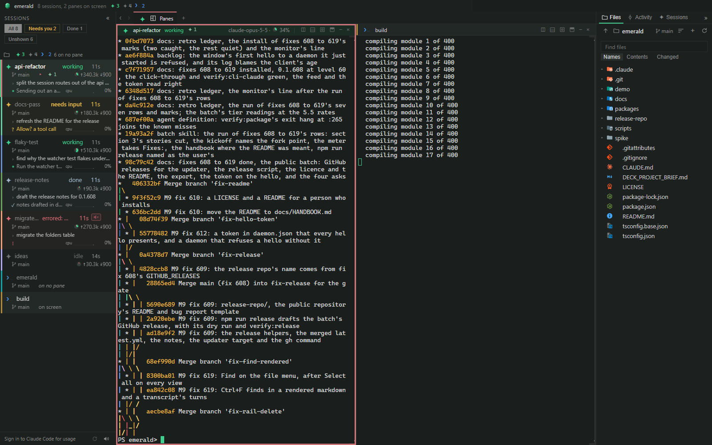

# Emerald

Emerald is a desktop app for running and supervising several Claude Code sessions at once on Windows.
Each session gets a pane in a split layout and a row in the sidebar that says whether it is working, waiting or needs you, beside the commit graph of the repository it works in.
A daemon owns the terminals, so closing the window leaves every session running and the next window picks them up.

This repository holds Emerald's code under the MIT licence, its installers on the releases page and its issues.



## Requirements

- Windows 10 or 11, on arm64 or x64.
- Git and Claude Code on the PATH.
- Node 24 or newer, only to build from source. The installed app brings its own.

## Install

Download the installer from the latest release at https://github.com/zacharykeeton/emerald/releases/latest: `Emerald-setup-<version>-x64.exe` for most PCs, `Emerald-setup-<version>-arm64.exe` for an ARM PC (Settings, System, About shows the system type).

The installer is not signed, so Windows SmartScreen stops it the first time with "Windows protected your PC". Click **More info**, then **Run anyway**. That happens once per download. Your browser may also warn that the file is not commonly downloaded; keep it.

The install is per user and needs no admin rights. It goes to `%LOCALAPPDATA%\Programs\emerald`, adds the `emmer` command to your PATH for any terminal opened afterwards, puts Emerald in the Start menu and on the desktop, and starts it. It also adds **Open in Emerald (Claude)** and **Open in Emerald (shell)** to Explorer's right-click menu on a folder and on a folder's empty space (under **Show more options** on Windows 11); either opens a new tab in Emerald with a Claude session or a shell started in that folder.

## First launch

Emerald learns what each Claude Code session is doing from Claude Code's hooks, so the first window shows a banner: "Claude Code hooks are not installed, so emerald cannot see what its sessions are doing." **Install hooks** writes them into `~/.claude/settings.json` beside any hooks you already have; **Not now** hides the banner until the next start. The banner's **Test** button sends one event through the installed hook, to check it reaches the app.

Installing the hooks also takes Claude Code's status line slot, since the status line is the only place Claude Code reports the model and how full the context window is. Your previous status line is kept and still runs after Emerald's, so it shows as before, and `emmer hooks uninstall` puts it back. The same step adds the `emmer-cli` skill to `~/.claude/skills`, so a Claude session knows how to drive the other sessions with `emmer`.

Sessions started before the hooks were installed report nothing; start them again, or resume them, once the banner is gone.

## Updates

Emerald checks the releases every few hours. When a new one is out it downloads on its own, and once it is ready a badge at the right of the title row reads **Restart to update**. Click it to close the window, install the new version and start it again, about a minute in all; every pane comes back through Resume. Nothing installs until you click. If the download fails, the badge reads `Retry <version>`; click it to try again.

## Uninstall

1. Remove Emerald in Settings, Apps, Installed apps. That removes the program, the PATH entry, the "Open with" entries for `.md` and `.json`, the two **Open in Emerald** items, and Emerald's hooks in `~/.claude/settings.json`, putting your previous status line back and removing the `emmer-cli` skill. An Emerald older than 0.1.620 leaves the hooks behind: there, run `emmer hooks uninstall` in a terminal first.
2. What stays, for you to delete if you want it gone: `~/.emerald` (your layouts, the session list and the logs), `%APPDATA%\emerald` (the window's own settings) and `%LOCALAPPDATA%\emerald-updater` (downloaded installers).

## Build from source

With Git and Node 24 or newer:

```
git clone https://github.com/zacharykeeton/emerald.git
cd emerald
npm ci
npm run build
npm run build -w @emerald/app
npm run dist -w @emerald/app -- --x64
```

On an x64 PC that writes `packages/app/release-x64/Emerald-setup-<version>-x64.exe`. On an ARM PC leave out `-- --x64`; the installer lands in `packages/app/release/` as `Emerald-setup-<version>-arm64.exe`. Run the installer as above. One you built yourself carries no mark of the web, so SmartScreen does not stop it.

The first `dist` downloads Electron and the NSIS tools; later builds take a few minutes. A build of your own never shows the update badge; to update, `git pull`, run the four build commands again and install the new installer over the old one. Your sessions and layouts stay.

## Reporting a bug

Open an issue at https://github.com/zacharykeeton/emerald/issues; the template asks for what follows. Say what you did, what you expected and what happened, and include:

- the version, from `emmer --version` or the app menu;
- whether the PC is arm64 or x64;
- the logs from `~/.emerald/logs`: `emmerd.log` (the daemon), `main.log` (the window) and `hooks.jsonl` (what Claude Code reported). They name your folders and sessions, so read them before you attach them.

## Contributing

Issues are welcome. Pull requests are read but not merged, since the code here is copied from a private working tree at each release; [CONTRIBUTING.md](CONTRIBUTING.md) says how a change gets in, and [SECURITY.md](SECURITY.md) how to report a security hole privately.

## Licence

MIT; the full text is in [LICENSE](LICENSE), and the licences of the packages Emerald ships with are in [THIRD-PARTY-NOTICES.md](THIRD-PARTY-NOTICES.md). The licence covers the code; it grants no right in the name Emerald or its icon.

## More

Everything else (every view, the `emmer` command line, the keys, how the app is built and tested) is in the handbook, [docs/HANDBOOK.md](docs/HANDBOOK.md).
